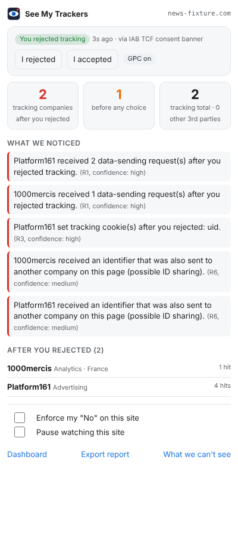

# See My Trackers

**See which companies your browser talks to after you click "Reject" on a cookie banner.**

Cookie banners promise a choice. A 2024 study of ~97,000 websites found that over 65% of sites offering an opt-out still collect data after you refuse (Bouhoula et al., USENIX Security 2024). See My Trackers lets you check this yourself on every site you visit, with evidence you can export.



<sub>Popup on the end-to-end test site (simulated trackers). Real-site results are in the validation report.</sub>

## What it does
- 🧾 **Consent receipt:** records what you chose, when, and how. Supported: IAB TCF, IAB GPP / US Privacy, OneTrust, Cookiebot, Didomi, Usercentrics, Google Consent Mode, or your own "I rejected" mark.
- 🔴 **After-reject audit:** which tracking companies were contacted after your "no", and whether they received data, set or read cookies, shared an ID with another company, or ran fingerprinting code.
- 🏢 **Named companies:** domains mapped to the companies that own them, with category, country and privacy contact.
- 🌍 **Cross-site profile:** "Google showed up on 41 sites; 12 of them after you rejected."
- 📄 **Evidence export:** HTML report + JSON, with identifiers hashed.
- 🛑 **Enforce my "No":** one switch blocks those companies on that site and deletes their cookies.
- ✋ **Global Privacy Control:** sends the legally recognized US opt-out signal (on by default).
- 🔒 **Local-only:** no servers, accounts or analytics. The extension makes **no network requests of its own**.

## Install

> Store listings (Chrome Web Store, Edge Add-ons, Firefox Add-ons) are pending review. Until then, install from a release.

### Chrome, Brave, Opera, Vivaldi (any Chromium 111+)
1. Download `see-my-trackers-1.0.0-chrome.zip` from the [latest release](../../releases/latest) and unzip it.
2. Open `chrome://extensions` and turn on **Developer mode** (top right).
3. Click **Load unpacked** and select the unzipped folder (the one that contains `manifest.json`).
4. Pin the 👁 icon: puzzle-piece menu → pin **See My Trackers**.

### Microsoft Edge
1. Download `see-my-trackers-1.0.0-edge.zip` and unzip it.
2. Open `edge://extensions` and turn on **Developer mode** (left panel).
3. Click **Load unpacked** and select the unzipped folder.

### Firefox 140+ (desktop)
1. Download `see-my-trackers-1.0.0-firefox.zip`.
2. Open `about:debugging#/runtime/this-firefox` → **Load Temporary Add-on…** → select the zip (or `manifest.json` inside it).
3. Temporary add-ons are removed when Firefox restarts. The permanent, signed version will come from Firefox Add-ons.

### Safari
Not supported. Safari doesn't let MV3 extensions observe network requests, which is the core of how this works.

## Use it
1. Visit a website and click **Reject all** (or "Necessary only") on its cookie banner.
2. Watch the toolbar icon: **red number** = tracking companies contacted *after* you rejected; **orange** = before any consent choice was recorded.
3. Click the icon to see which companies, what they did, and the findings. **Export report** saves the evidence.
4. Optional: **Enforce my "No"** blocks those companies on that site. **Dashboard** shows the cross-site view.

If a site uses a custom banner the extension can't read, click **I rejected** in the popup so your choice is still recorded.

## Findings
| Rule | Meaning | Severity |
|---|---|---|
| R1 | A tracking company received data (beacon, pixel, collect call) after you rejected | High |
| R2 | A tracking company was contacted after you rejected (shares your IP and the page) | Medium |
| R3 | A tracking cookie was set after you rejected | High |
| R4 | An existing tracking cookie was still sent after you rejected | High |
| R5 | A third-party script used fingerprinting-prone APIs (canvas, WebGL, audio, fonts) after you rejected | Medium (heuristic) |
| R6 | The same identifier was sent to two or more companies (ID sharing) | High |
| R7 | The consent banner recorded "accepted" after you marked "rejected" | High |
| R8 | GPC was sent, but the site's US privacy signal says you didn't opt out | Medium |
| R9 | Tracking before any consent choice was recorded | Medium |
| R10 | Google Consent Mode "denied" pings still sent (no cookies, but page and device details) | Info |

On US sites, "rejected" means **opted out of sale/sharing** (GPP / GPC). US law still allows some processing after that opt-out, and the extension words its findings accordingly.

## Limits (also shown in the extension)
No browser tool can see data that sites forward **server-to-server**. Trackers disguised as the site's own subdomain aren't counted. Fingerprinting detection is heuristic. Results are **observations, not legal verdicts**. Full list: [LIMITATIONS.md](LIMITATIONS.md).

## Validation
- Automated end-to-end tests pass in **Chromium 153** and **Firefox 161**: consent receipt, every finding type, GPC header + JS signal, Enforce blocking, no raw IDs in exports.
- **Real sites (Chrome, macOS):** every company reported after a reject was confirmed in the browser's own network log (6/6). In a 16-site automated run, 49 of 51 were confirmed; the other 2 were cookie-only events with no network request to match.
- Details: [docs/validation/2026-11-24-validation.md](docs/validation/2026-11-24-validation.md).

## Build from source
Requirements: Node 22+, npm.
```bash
npm ci
npm run data        # regenerate data/trackers.json from Ghostery TrackerDB
npm test            # unit tests (node:test)
npm run typecheck
npm run build       # → dist/chrome, dist/edge, dist/firefox
npm run package     # → release/*.zip (+ source zip for AMO review)
```
End-to-end tests:
```bash
node tests/e2e/chrome.e2e.mjs                                                  # needs Chrome/Chromium (CHROME_BIN)
SMT_TEST=1 node scripts/build.mjs firefox && node tests/e2e/firefox.e2e.mjs    # needs Firefox (FIREFOX_BIN)
node tests/e2e/real-sites.mjs                                                  # real-site run (network)
```

## How it works
- **Background** (Chrome service worker / Firefox event page) observes requests with `webRequest` (observation only; pages can't hide from it). It classifies third parties with the bundled tracker database and labels each event by phase: *before any choice*, *after you rejected*, *after you accepted*, *no banner*.
- **Page probe** (main world, `document_start`) reads consent platforms' public APIs and notes calls to fingerprinting-prone APIs. It never changes page behavior.
- **Rules engine** (pure TypeScript, unit-tested) turns events + consent receipts into findings with severity and confidence.
- **Enforce** uses `declarativeNetRequest` rules scoped to that site.

Design spec and plan: [`docs/superpowers/`](docs/superpowers/). Contributor/agent guide: [AGENTS.md](AGENTS.md).

## Privacy
Everything stays on your device. URL parameter values are replaced with salted hashes before storage. See [PRIVACY.md](PRIVACY.md).

## Roadmap
- v1.1: auto-reject banners (via `@duckduckgo/autoconsent`), Firefox CNAME uncloaking.
- v1.2: three evidence levels (identified you / received data / contacted) and a "no declared legal basis" check against the IAB vendor list.
- v2.0: first-party and self-hosted analytics detection (PostHog, Matomo, Plausible, Umami, proxied GA, session replay).

## License
- Code: **GPL-3.0-or-later** ([LICENSE](LICENSE)).
- Tracker data (`data/trackers.json`): derived from [Ghostery TrackerDB](https://github.com/ghostery/trackerdb), **CC BY-NC-SA 4.0** ([data/LICENSE](data/LICENSE)). Distributions that include it are **non-commercial**.
